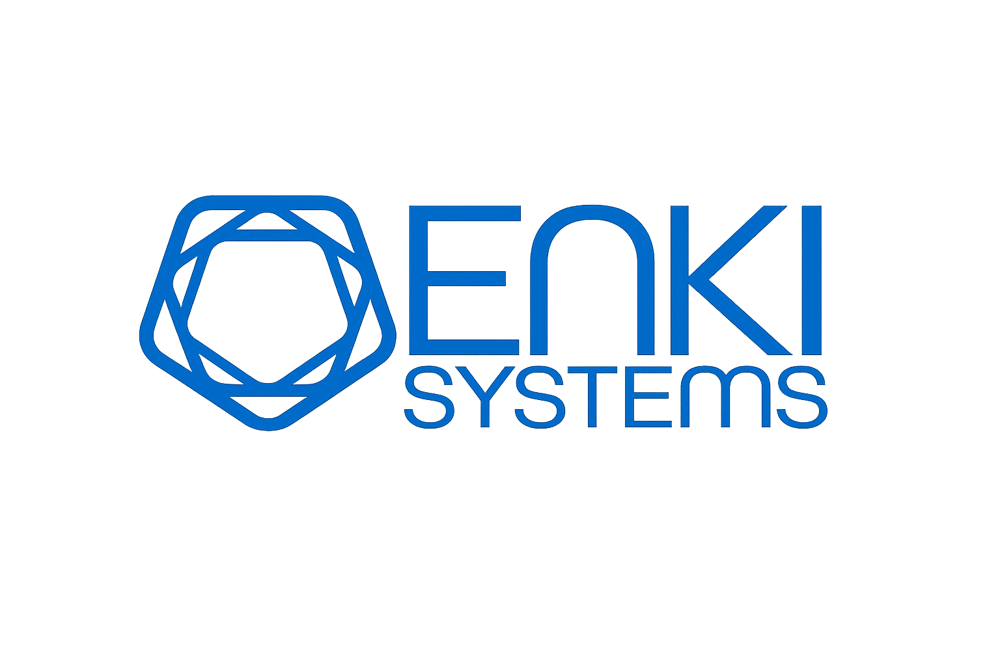

<!-- SPDX-License-Identifier: BUSL-1.1 -->
<p align="center">
  
</p>

# Enki Governance

**Fully offline LLM collapse: turn a pile of documents into a governed, sourced fact graph — on your own hardware, with every claim backed by a receipt, and the system abstaining when it isn't sure.**

Enki Governance is a deterministic, **fully offline** intelligence-collapse engine. You feed
it documents; a **local LLM** extracts statements, then the engine *collapses* them into a
governed graph of entities and typed, sourced relationships — all on your own machine, with
**nothing leaving it**. It is:

- **Offline & private** — the LLM runs locally (via [Ollama](https://ollama.com)); no external
  API, no accounts, no telemetry, **your data never leaves your machine**. Runs fully
  **air-gapped** for document ingestion; live [connectors](docs/CONNECTORS.md) are opt-in and
  only pull public sources *in*.
- **Deterministic** — the same input and the same packs produce the same output. No dice rolls.
- **Abstaining** — when the evidence is ambiguous, it says *"unknown"* instead of guessing.
- **Sourced** — every collapsed fact links back to the exact sentence and document it came from.
- **Composable** — behavior is governed by versioned **packs** (a base-60 vocabulary spine)
  you can run, author, or extend yourself.

> This is the open, free core of the Enki platform. It is **not** a surveillance or
> tracking product — see [Limitations](#limitations).

---

## See it in ~60 seconds

```bash
git clone https://github.com/BradBuilds/enki-governance.git
cd enki-governance
cp .env.example .env          # defaults work for local dev
docker compose up -d          # postgres + ollama + api + ui
./scripts/first-run.sh        # migrations → pull local model → import packs → seed
```

Open the UI (default `http://localhost:5173`), drop in a PDF, and watch it collapse into a
sourced entity/fact graph. Or run the **worked example** — one memo in, a governed fact graph
out — see **[examples/](examples/)** (`./examples/run.sh`). Full walkthrough in
[SETUP.md](SETUP.md).

---

## How it works

```
documents ──► extract statements ──► GOVERNED COLLAPSE ──► entity + fact graph
                                          │                     (every edge sourced)
                                    packs decide:
                                    correct → validate → abstain → admit
```

1. **Ingest** — PDFs/text in; OCR and statement extraction produce candidate claims.
2. **Collapse** — the governed engine resolves entities and types each relationship using
   the **packs** (the vocabulary spine). It admits only what validates; it abstains on the rest.
3. **Graph** — the result is an auditable graph: entities, typed edges (e.g. `met_with`,
   `employed`, `owns`), each backed by its source quote and document.

For the full model — the five-layer governed spine, the base-60 substrate and how it's
governed, and cross-node identity — see **[ARCHITECTURE.md](ARCHITECTURE.md)**.

The **packs** are the key. They define the entity types, the relationship edges, the
verb→edge mappings, and the collapse policies. Ship-included packs get you running; you can
author your own, or receive updates as the community advances them
(see [CONTRIBUTING.md](CONTRIBUTING.md) — *"join a project to collapse language"*).

---

## Deterministic mode — governance & audit without the LLM

The LLM is used for **one thing only**: proposing entity mentions and statements from prose.
Everything downstream — the **governed spine** — is fully deterministic and runs with **no
model at all**:

- **Collapse** existing statements into typed, sourced assessments (`promote_pending` /
  `promote_corpus`) — no LLM involved.
- **Validate & audit** — schema, semantics, type-pair legality, the collapse equation,
  chain-of-custody, content-hash and active-set signature verification (`core/validation`,
  `core/spine`) — all pure deterministic checks.

So you can run Enki purely as a **governed audit / verification layer**: feed it
pre-structured statements, or re-collapse and verify existing data, and get the same
receipted, reproducible result every time — **without any LLM**. The model is an optional
front-end for turning prose into structure; the governance underneath stands on its own.

## The LLM extraction — CPU vs GPU (important)

Extraction is **included and runs fully offline** — no external API, no accounts, no data
leaving the box (works air-gapped). A **local model** ([Ollama](https://ollama.com))
*proposes* entity mentions and statements from each paragraph; the governed spine then decides
what to admit. All of it ships here: `core/ai/` (providers),
`core/documents/batched_extractor.py`, `core/extraction/`, `core/workers/collapse_worker.py`.

**Default model:** [`gemma4:e2b`](https://ollama.com/library/gemma4) — Google's
**[Gemma](https://ai.google.dev/gemma)** (Gemma 4, ~5 B params, multimodal, 128k context,
Q4_K_M quant, ~7 GB). It's pulled automatically by `first-run.sh` from the public Ollama
registry — no account needed. Use of Gemma is under the
[Gemma Terms of Use](https://ai.google.dev/gemma/terms).

**What you get depends on the model + hardware:**

- **CPU + the default `gemma4:e2b`**: the engine ingests, extracts **entities**, and
  collapses them — but structured **relationship** extraction is slow and hit-or-miss (a
  small model on CPU struggles to emit clean JSON). Great for trying it out.
- **GPU + a capable model**: the **full** extraction — entities *and* typed, sourced
  relationships (`met_with`, `employed`, `owns`, …) — the complete governed fact graph.

**Upgrade the model** any time (bigger = better/cleaner extraction) by setting one line in
`.env`, then `docker compose up -d && ./scripts/first-run.sh`:

| `OLLAMA_MODEL` | Params | Runs on | Extraction |
|---|---|---|---|
| [`gemma4:e2b`](https://ollama.com/library/gemma4) *(default)* | ~5 B (eff. 2 B) | CPU / ~6 GB VRAM | entities; light relationships |
| [`gemma2:9b`](https://ollama.com/library/gemma2) | 9 B | ~8–10 GB VRAM | full relationships |
| [`qwen2.5:14b`](https://ollama.com/library/qwen2.5) | 14 B | ~12–16 GB VRAM | full, higher quality |

**To turn on the GPU:** install `nvidia-container-toolkit`, uncomment the `deploy:` block
under the `ollama` service in `compose.yaml`, then `docker compose up -d`.

The **governance/collapse layer is identical** on any model — determinism, receipts, and
abstention never change. Only the *proposals* get better; the governance decides the same way.

## Live connectors — pull news & APIs in, not just PDFs

Enki isn't only a "drop a folder of documents" tool. It ships a connector framework so you can
point it at **live sources** and have it poll them on a schedule, collapsing each new item into
the same governed, sourced graph:

- **RSS / Atom feeds** — subscribe to news or blogs; each new entry is ingested and collapsed.
- **Any JSON REST API** — map an endpoint's fields into documents (`http_api`).
- **Watch folder** — drop files (PDF, CSV, email, ZIP/Takeout, …) into `/data/inbox/`.
- Plus a built-in **[GDELT](https://www.gdeltproject.org/)** global news-event sync for the map.

A background scheduler polls each connector on its interval; every item runs the normal
**extract → governed collapse → sourced graph** path. Add one from the **Connectors** dashboard
(Test-connection before you save) or the API — full guide in **[docs/CONNECTORS.md](docs/CONNECTORS.md)**.

> **Offline, honestly:** connectors are *opt-in* and make **outbound fetches to pull public
> data in** — they never send your data out. Want fully air-gapped? Just don't configure any;
> the engine and governed spine work with zero network.

## Enrich against public records — bring your own keys

Beyond documents and connectors, Enki can enrich entities against **public-record and open-data
sources**. Many need **no key** — SEC EDGAR, CourtListener (US courts), OFAC + UN sanctions,
Wikidata/Wikipedia, OpenCorporates search. The rest are **bring-your-own-key**: paste your own
credential in **Settings → Data sources** (or set an env var of the same name) and it works —
each key deepens coverage and lifts rate limits.

| Your key unlocks | Source |
|---|---|
| `DATA_GOV_API_KEY` | FEC donor money-trails, Congress.gov, OpenFDA |
| `OPENCORPORATES_API_TOKEN` | Full company officers + corporate-empire mapping |
| `OPENSANCTIONS_API_KEY` | Real-time sanctions + PEP / corruption topics |
| `COMPANIES_HOUSE_API_KEY` | UK directors, filings, appointment history |
| `SAM_GOV_API_KEY` | US federal contractor records (UEI/CAGE) |
| `GEONAMES_USERNAME` · `PROPUBLICA_NONPROFITS_API_KEY` · `FAA_REGISTRY_BULK_ENABLED` | Places · nonprofit 990s · aircraft registry |

Every fact an enrichment admits is **collapsed and receipted** like any other document — traceable
to the source record. Free tiers give you a working system; your keys deepen it. Full list, what
each unlocks, and signup links: **[docs/DATA_SOURCES.md](docs/DATA_SOURCES.md)**.

**Satellite imagery** — the map overlays ESA **Copernicus Sentinel-2** and captures overhead of
an entity's coordinates as evidence; paste a free [Copernicus](https://dataspace.copernicus.eu/)
WMS instance in **Settings → Satellite**.

## The workspace

The engine ships with a full UI, not just an API — a dashboard, a live **Feed**, an interactive
**Map** (tracks, reference layers, satellite), per-entity **dossiers** with a 3-D fact graph,
a relationship **Graph**, **Library** browser, **Chat** over your corpus, **Connectors** and
**Settings** (data-source keys, satellite, privacy). Everything the collapse engine produces is
navigable here, every claim carrying its receipt. Default: `http://localhost:5173`.

## Optional: the WordNet sense layer

The core ships all **47 governance packs**. Two of them — the WordNet sense packs — hold
large derived data that we build from an established open project rather than commit to git:
**[Open English WordNet](https://github.com/globalwordnet/english-wordnet) (`oewn:2023`, CC-BY-4.0)**,
via the [`wn`](https://github.com/goodmami/wn) library. Enable sense-grounding with:

```bash
./scripts/import-lexicon.sh
```

This downloads OEWN (~35 MB), builds ~120k senses + sense-frequency into the two packs, and
loads them into the spine. Core collapse works fine without it — this adds word-sense
disambiguation. Because it goes through `wn`, you can also pull **other or multilingual
wordnets** for broader coverage (`wn download <lexicon>`), and the domain glossaries
(legal, finance, intel, military, cyber, biomed) already ship in the packs.

## Requirements

Needs **Docker + Docker Compose**. **No accounts or API keys are required to run** — the model
runs locally via [Ollama](https://ollama.com). Keys are *optional* and only deepen public-record
enrichment ([bring your own](#enrich-against-public-records--bring-your-own-keys)).

| | Minimum (CPU) | Recommended (GPU) |
|---|---|---|
| CPU | 4 cores | 8+ cores |
| RAM | 8 GB | 16 GB+ |
| GPU | none (CPU inference) | NVIDIA, **6 GB VRAM** for the default; 12–16 GB for larger models |
| Disk | ~15 GB (model ~7 GB + images + DB) | 20 GB+ |
| Gives you | ingest + entity extraction | **full typed-relationship fact graph** |

The stack (`postgres + ollama + api + ui`) runs on CPU out of the box. A GPU is what unlocks
the full extraction pipeline (see above) — not required to try it, strongly recommended for
real use.

---

## Limitations

Stated plainly so nothing is oversold:

- **Not** a surveillance/tracking product — no device tracking, ALPR, or TAK here.
- **Single-node** self-host; multi-node federation is not part of this repo.
- **Free/open connectors included** (RSS, JSON REST APIs, GDELT global news, folder-watch — see
  [docs/CONNECTORS.md](docs/CONNECTORS.md)); **paid/commercial and surveillance connectors are
  not** part of this repo. Bring your own sources.
- **Quality tracks the packs** — collapse is only as good as the governed vocabulary. Sparse
  packs mean more abstentions. That is by design: it says *"unknown"* rather than guessing.
- **LLM-assisted, not LLM-authoritative** — a local model proposes; the governed spine
  decides. Results vary by model.
- **Early software** — schemas and pack formats may change before a stable release.

---

## Contributing

The packs are a **commons**. If you see a relationship, verb mapping, or entity type the
engine doesn't know, propose it — every contribution is itself governed
(`correct → validate → abstain → admit`) and credited. See [CONTRIBUTING.md](CONTRIBUTING.md).

**Fitting Enki to a new domain?** The engine abstains on relationships it has no edge for and
**queues them with evidence** — so your documents tell you exactly what vocabulary to add.
[docs/OPERATING.md](docs/OPERATING.md) walks the governed edge-growth loop, including how an
AI coding agent (Claude Code in VS Code) can draft grounded pack changes under your approval.

## Acceptable use

Enki Governance is a tool for **lawful** document analysis. You are responsible for the data
you process and must comply with all applicable laws.

- **Do not** use it to process, store, or distribute illegal content — including child sexual
  abuse material (CSAM) — or to conduct unlawful surveillance or violate privacy/data-protection law.
- Because the engine keeps **receipts** (source quotes) and can retain source documents,
  handle any sensitive corpus accordingly and secure your deployment.
- These are conditions of use in addition to the license terms below.

## License

Business Source License 1.1 (BUSL-1.1). Self-host and inspect freely; competitive/commercial
hosting is restricted until the change date, when it converts to Apache-2.0. See [LICENSE](LICENSE).
